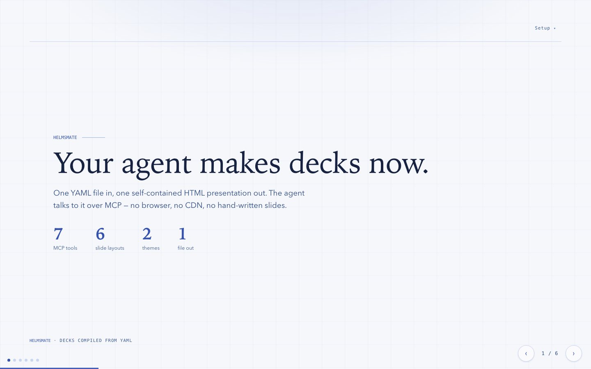
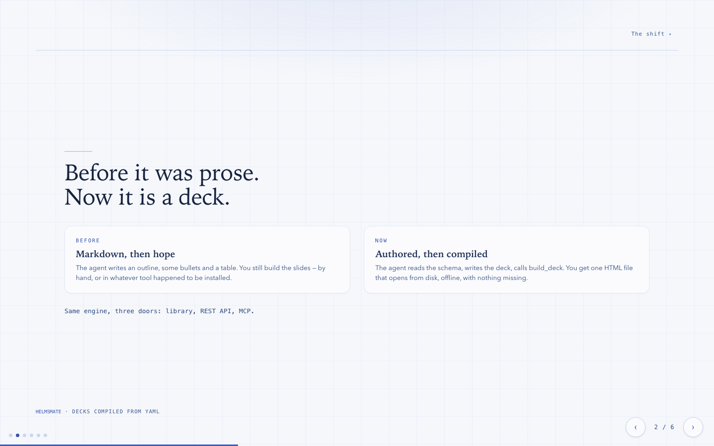
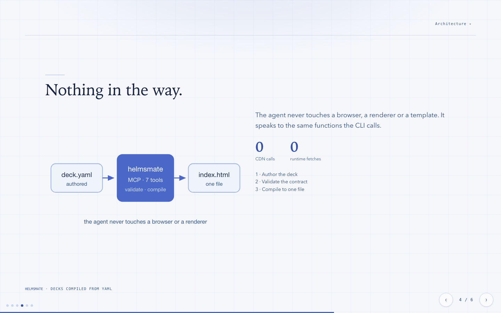
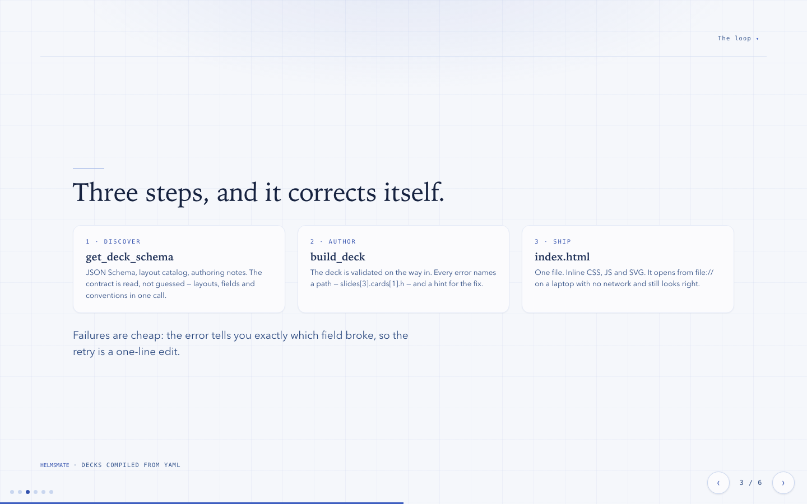

# helmsmate

> **A slide deck that lives in a text file.**

HelmsMate turns one YAML file into one self-contained HTML presentation. No
framework, no CDN, no runtime fetches — the output is a single `index.html`
you can email, drop on a USB stick, or open from disk on a laptop with no
internet.

It was built for the era of AI-written code. A coding agent can read the deck
format, author a deck, and hand you back a finished presentation, because the
engine exposes itself over MCP.



## What it looks like

Six layouts cover most decks: an opener, two- and three-card grids, a
figure-and-text split, a closing slide, and a centred media frame.



An inline SVG sits in the figure slot. Draw it yourself, or let the agent
draw it for you.



Three columns when the argument has three parts.



## What it does

- **One file out.** HTML, CSS, JS and SVG inlined. It opens from `file://`.
- **Content in, structure out.** You write words. The engine owns layout,
  theming, navigation and the fiddly parts.
- **Six layouts, two themes.** `mariners-chart` (beacon blues, light) and
  `archive-trace` (archive paper and vermilion, light and dark).
- **Ships to other software.** The same engine is a Python library, a REST API
  and an MCP server.
- **Speaks to your coding agent.** Ask for a deck; the agent reaches for
  HelmsMate on its own and returns an HTML file.
- **Editable.** The authored YAML sits next to the built HTML, so a change is
  a change to the source, not a patch to generated markup.
- **Checks itself.** A verification script asserts the things that quietly
  break: frozen header, no horizontal overflow, equal card heights, footer
  in view, counter centred.

## Install

The short way is one prompt you paste into your coding agent — Claude Code,
Cursor, MiniMax Code, anything with a shell. It clones the repo, installs the
dependency, registers the MCP server, installs the companion skill, and builds
a deck to prove it works.

```
Set up HelmsMate for me.

HelmsMate compiles one YAML deck into a single self-contained HTML
presentation, and exposes itself to you as MCP tools so you can build decks on
request.

Do the whole job without stopping to ask me questions, unless something
genuinely blocks you.

1. Get the code.
   git clone https://github.com/thecont1/helmsmate.git ~/tools/helmsmate
   Skip the clone if ~/tools/helmsmate already exists — use what is there.

2. Install and wire it up.
   cd ~/tools/helmsmate
   python3 -m venv .venv
   .venv/bin/pip install --upgrade pip
   .venv/bin/pip install PyYAML
   .venv/bin/python scripts/install.py --client <client> --python "$PWD/.venv/bin/python"

   <client> is the coding agent you are running inside: claude, cursor,
   minimax, or all. If you are not sure, run it with --client auto — it
   registers with every client it finds on this machine.

   If scripts/install.py is missing or fails, do the same four things by hand
   (they are written out in docs/INSTALL.md inside the repo):
     a. an interpreter with PyYAML,
     b. an MCP server entry in your client's config,
     c. the companion skill in your agent's skills directory,
     d. a verification build.

3. Restart or reload yourself so the new MCP server is picked up. Then confirm
   you can see seven tools: list_themes, list_layouts, get_deck_schema,
   validate_deck, build_deck, list_decks, read_deck.

4. Prove the loop end to end. Call get_deck_schema, author a two-slide deck
   against it, call build_deck, and open the index.html it returns.

5. Report back: where the checkout is, which client you registered, where
   decks will be written, and the path of the deck you just built.
```

If you would rather do it yourself, [`docs/INSTALL.md`](docs/INSTALL.md) has the
same procedure as manual steps.

## Use

**Ask your agent.** "Make me a six-slide deck on the retrieval-augmented
generation results." It reads the schema, writes the deck, builds it, and
hands you the file. Every error it hits names the field that broke, so the
retry is a one-line fix.

**Write YAML yourself.** One file, one command:

```bash
python -m helmsmate.cli build deck.yaml --out index.html
```

**Call it from code.**

```python
from helmsmate import build_html, validate_deck

result = build_html(deck_dict)          # -> .html, .slides, .warnings, .outline
problems = validate_deck(deck_dict)     # -> [ValidationIssue(path, message, hint)]
```

**Serve it to other software.**

```bash
python -m helmsmate.cli serve --port 8787
```

The full API — build, validate, list, read back — is in
[`docs/api.md`](docs/api.md).

## How it works

The deck format, the layout registry, the engine invariants, the REST and MCP
surfaces, the installer, and the verification harness are all documented in
[`TECH-SPEC.md`](TECH-SPEC.md).

The short version: everything editorial lives in `deck.yaml` and everything
structural lives in the engine. One table of layouts and fields
(`helmsmate/spec.py`) is the single source of truth — the renderer draws from
it, the validator checks against it, and the API and MCP layers publish it as
JSON Schema. A layout cannot change in one place and stay stale in another.

## Tests

```bash
python -m unittest discover -s tests -t .   # the suite
python scripts/smoke.py                     # does the service actually work?
```

## License

MIT.
